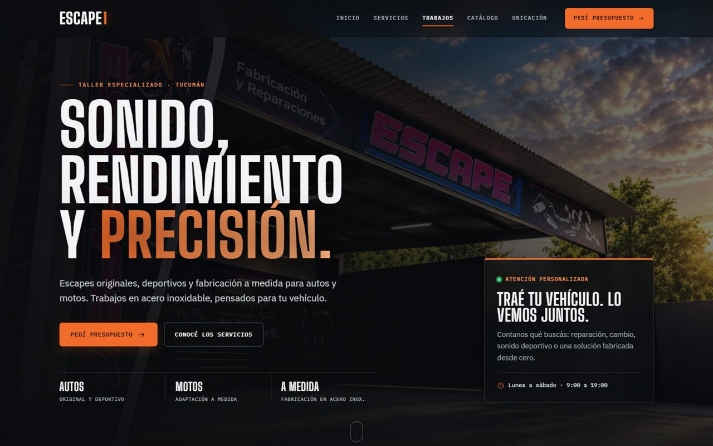
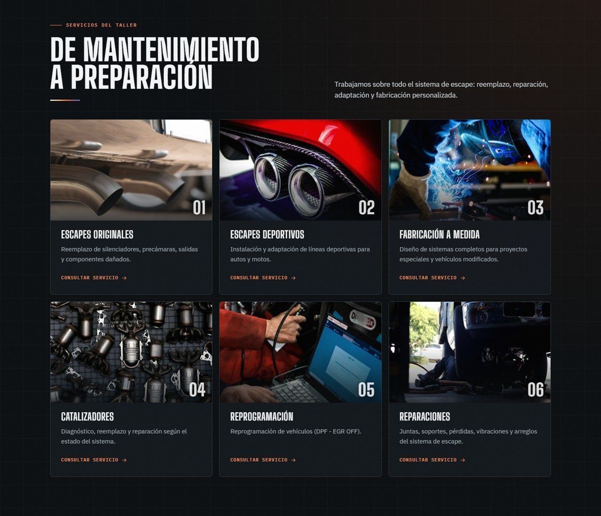
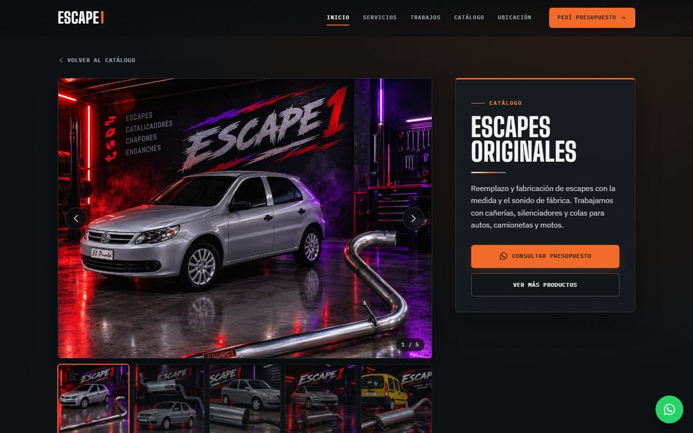
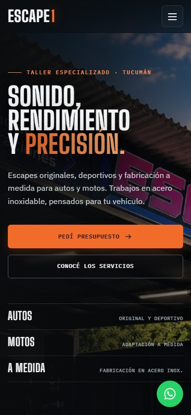

# Escape1: sitio web para taller de escapes

Sitio web para **Escape1**, un taller de escapes para autos, camionetas y motos de San Miguel de Tucumán, Argentina. Desarrollado con **React** y **Vite** para un cliente real.

**🔗 Ver online: [tallerescape1.com](https://tallerescape1.com/)**



## Funcionalidades

- **Catálogo con fichas de producto:** cada categoría tiene su propia página (`/catalogo/<producto>`) con visor de fotos, miniaturas y navegación con flechas del teclado.
- **Posicionamiento en Google (SEO):** cada página se genera como HTML estático en el build, con título, descripción y link canónico propios. Cada servicio tiene su página con texto propio y preguntas frecuentes, y la home tiene una sección de preguntas frecuentes. Incluye datos estructurados (schema.org `AutoRepair`, `Service`, `FAQPage` y `BreadcrumbList`), `sitemap.xml` con imágenes, `robots.txt`, página 404 propia e imágenes para que el link se vea bien al compartirlo por WhatsApp o redes.
- **Rendimiento:** fuentes servidas desde el propio sitio (con preload de las que se ven primero), fotos en `.webp`, miniaturas para las grillas, imagen de portada más liviana en celulares y caché del navegador configurada en `.htaccess`.
- **Presupuestos y turnos por WhatsApp:** los formularios validan los datos y arman un mensaje prolijo que se abre directo en WhatsApp, el canal principal del taller con sus clientes. Desde un servicio o un producto, el formulario se precarga solo.
- **Galería de trabajos:** fotos y videos por categoría (autos, camionetas y motos). Los videos se reproducen solos solo mientras están en pantalla, para ahorrar datos y batería, y se abren en un visor navegable.
- **Diseño responsive:** pensado primero para el celular, desde 360 px hasta pantallas grandes.
- **Animaciones sutiles:** aparición al hacer scroll, header que se compacta y franja de servicios en movimiento. Todo se desactiva si el usuario tiene activado "reducir movimiento".
- **Accesibilidad:** navegación completa por teclado, foco visible, textos para lectores de pantalla y "saltar al contenido".
- **Ubicación y contacto:** mapa embebido, horarios y contacto directo por WhatsApp, teléfono o email.

## Capturas

| Servicios | Ficha de producto | Celular |
|---|---|---|
|  |  |  |

## Tecnologías

- **React 19**: componentes funcionales y hooks.
- **Vite**: entorno de desarrollo y build.
- **CSS puro**: variables (design tokens), Grid, Flexbox y `clamp()` para tipografía fluida. Sin frameworks de estilos.
- **ESLint**: con las reglas de React Hooks.
- **Hostinger**: hosting del sitio (`public/.htaccess` hace que `/catalogo/<producto>` muestre su página).

Sin dependencias extra: el router de la ficha de producto, el prerender de las páginas, las animaciones de scroll y la integración con WhatsApp están hechos a mano.

## Cómo correrlo

Requiere [Node.js](https://nodejs.org/) en una versión LTS reciente.

```bash
git clone https://github.com/nico-git7/escape1-react.git
cd escape1-react
npm install
npm run dev
```

Abrí `http://localhost:5173`.

| Comando | Qué hace |
|---|---|
| `npm run dev` | Servidor de desarrollo con recarga en vivo |
| `npm run build` | Build de producción en `dist/` (con el HTML de cada página, `sitemap.xml` y `robots.txt`) |
| `npm run preview` | Sirve el build localmente |
| `npm run lint` | Revisa el código con ESLint |

## Estructura

```
public/
└── .htaccess                # Hostinger: URLs limpias, redirecciones, página 404 y caché
scripts/
└── prerender.js             # Después del build: HTML de cada página, 404, sitemap y robots
src/
├── App.jsx                  # Layout general y router (home / ficha de producto)
├── main.jsx                 # Arranque en el navegador (hidrata el HTML generado)
├── entry-server.jsx         # Arranque para generar el HTML en el build
├── index.css                # Variables de diseño, reset y utilidades globales
├── components/
│   ├── Header.jsx           # Navegación con scroll-spy y menú mobile
│   ├── Footer.jsx
│   ├── Lightbox.jsx         # Visor de fotos y videos de la galería
│   ├── IconSprite.jsx       # Íconos SVG reutilizables
│   ├── FaqList.jsx          # Preguntas frecuentes desplegables (home y fichas)
│   ├── MainHome.jsx         # Arma la home con todas las secciones
│   └── sections/            # Hero, Servicios, Galería, Catálogo, Preguntas, Contacto…
├── pages/
│   ├── CatalogDetail.jsx    # Ficha de cada producto o servicio (texto, preguntas, relacionados)
│   └── NotFound.jsx         # Página 404
├── data/
│   ├── site.js              # Datos del negocio: teléfono, dirección, horario, redes, URL del sitio
│   ├── catalog.js           # Fichas: fotos, textos, preguntas frecuentes, servicio asociado
│   ├── services.js          # Servicios del taller (cada uno enlaza a su ficha)
│   ├── faq.js               # Preguntas frecuentes de la home
│   ├── gallery.js           # Fotos y videos de la galería
│   └── nav.js               # Links del menú
└── utils/
    ├── useRoute.js          # Router mínimo con URLs reales (History API)
    ├── seo.js               # Título, descripción, datos estructurados, sitemap y robots
    ├── useReveal.js         # Animación de aparición al hacer scroll
    └── whatsapp.js          # Armado de links y mensajes de WhatsApp
```

## Cómo actualizar el contenido

El contenido está separado del código, así que no hace falta tocar componentes:

- **Agregar un producto o servicio, o cambiar sus fotos:** editar `src/data/catalog.js`. La página nueva, su título para Google y su entrada en el sitemap se generan solas en el build. Para que posicione, conviene completar `content` (2 o 3 párrafos propios), `includes` y `faqs` con las palabras que usa la gente para buscar ("caño de escape", "silenciador", "tacho"…). Opcionales: `thumb` (miniatura cuadrada de 480 px en `public/img/miniaturas/`) y `shareImage` (imagen de 1200 × 630 en `public/img/compartir/` para cuando se comparte el link).
- **Cambiar las preguntas frecuentes de la home:** `src/data/faq.js`.
- **Sumar fotos o videos a la galería:** subir el archivo a `public/img/galeria/` o `public/video/galeria/` y agregarlo en `src/data/gallery.js`. Conviene subir las fotos en `.webp` y de no más de 1600 px de lado: las fotos del celular pesan varios MB y hacen lenta la página.
- **Cambiar el teléfono, la dirección, el horario o las redes:** `src/data/site.js` (también actualiza los datos que lee Google).
- **Publicar cambios:** Hostinger publica solo lo que hay en la rama `deploy` (implementación automática desde GitHub). Hay que generar el build y poner el contenido de `dist/` en esa rama:

  ```bash
  npm run build
  git worktree add ../escape1-deploy deploy   # solo la primera vez
  cd ../escape1-deploy
  git pull
  git rm -rq . && cp -a ../escape1-react/dist/. .
  git add -A && git commit -m "Deploy" && git push
  ```

  `dist/` incluye el archivo oculto `.htaccess`: tiene que estar sí o sí.
- **Si el sitio se muda a otro dominio:** cambiar `SITE_URL` en `src/data/site.js`.

## Créditos

Algunas fotos de servicios y categorías son de [Unsplash](https://unsplash.com/license), con licencia de uso libre. El detalle está en `public/img/stock/CREDITOS.txt`. Las fotos y videos de la galería y del catálogo son trabajos reales del taller.

---

Desarrollado por [@nico-git7](https://github.com/nico-git7).
